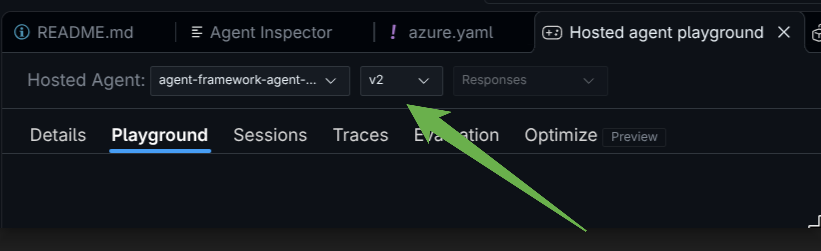

# Ü13 · Das Projekt als Hosted Agent bereitstellen

Dein Prüfworkflow läuft bisher lokal hinter `main.py`. Jetzt stellst du genau dieses Projekt
über **Foundry Toolkit → Deploy to Microsoft Foundry** in Foundry bereit. Deployment und Playground übernimmt VS Code.

**Ausgangspunkt:** dein Projekt nach Ü11 B (mit oder ohne Ü12).

## Schritt 1 · Lokal prüfen und Inhalt ansehen

F5, im Agent Inspector „Prüfe PR-001“ und „Prüfe PR-999“ senden. PR-001 liefert das Prüfergebnis
mit run_id, PR-999 JSON mit `fehler`. Stoppe den Debug-Lauf danach.

Bereitgestellt wird der Projektordner, den `azure.yaml` unter `project` nennt:
`main.py`, deine Module, `pyproject.toml`, `uv.lock` und `daten/`. Die Abhängigkeiten installiert Foundry
beim Bereitstellen aus den Projektdateien. `FOUNDRY_PROJECT_ENDPOINT` setzt der Foundry-Dienst in der Cloud
selbst; den Modellnamen gibt `azure.yaml` als Umgebungsvariable mit. Die Cloud verwendet die Identität des
Agenten; deine lokale Anmeldung wird nicht hochgeladen.

## Schritt 2 · Deployment in VS Code

1. Foundry Toolkit → **Developer Tools → Build → Deploy to Microsoft Foundry**.
2. **Foundry Project Setup**: Subscription `Kuenz Training 2026`, Project `kuenz-agents` → **Next**.
3. **Basics**: Deployment Method **Code**, Package Mode **Remote**, Deploy to **New agent**,
   Hosted Agent Name `kuenz-pruefung-trainingNN` (NN = deine Teilnehmernummer) → **Next**.
4. **Review + Deploy**: Python (Auto-detected), Python 3.13, Entry Point `python main.py`,
   0.5 CPU / 1.0 Gi → **Deploy**. Unten rechts erscheint „… is deployed successfully“.
5. Unter **My Resources → Agents → Hosted Agent → Details** den Laufstatus abwarten.
6. **Playground**: „Prüfe PR-001“, „Prüfe PR-201“, „Prüfe PR-999“ testen.
   Notiere Agentname, getestete Version, Endpunkt, response_id und run_id.

**Code geändert?** Erneut deployen, unter **Basics** aber **Existing agent** und deinen Agentnamen wählen.
Foundry legt dann eine neue Version an (`v2`, `v3`, …).

Wähle im Playground oben die neue Version **aktiv aus**. Sonst testest du weiter die alte Version.



Welche Version geantwortet hat, zeigt Schritt 3 unter `agent`.

## Schritt 3 · Gespeicherte Antwort mit dem SDK abrufen

Jeder Aufruf im Playground startet eine neue Prüfung. Mit der response_id liest du dagegen eine
gespeicherte Antwort aus Foundry, ohne neu zu prüfen. So siehst du, welche Version geantwortet hat.

1. Im Projektordner `pruefagent/src/agent-framework-agent-basic-responses` die Datei `abruf.py`
   anlegen und diesen Code einfügen:

   ```python
   import os
   from azure.ai.projects import AIProjectClient
   from azure.identity import DefaultAzureCredential
   from dotenv import load_dotenv

   load_dotenv(".env")
   with AIProjectClient(endpoint=os.environ["FOUNDRY_PROJECT_ENDPOINT"],
                        credential=DefaultAzureCredential(), allow_preview=True) as project:
       with project.get_openai_client(agent_name="kuenz-pruefung-trainingNN") as client:
           response = client.responses.retrieve("response_id-aus-dem-Playground")
           print(response.id, response.status, response.output_text)
           print(response.model_dump().get("agent"))  # tatsächlicher Agentname und Version
   ```

2. Im Code zwei Werte ersetzen:
   - `kuenz-pruefung-trainingNN` durch deinen Agentnamen aus Schritt 2,
   - `response_id-aus-dem-Playground` durch eine response_id, die du in Schritt 2 notiert hast
     (beginnt mit `caresp_`).
3. Datei speichern und im Terminal ausführen:

   ```bash
   cd /workspaces/kuenz-maf-training/pruefagent/src/agent-framework-agent-basic-responses
   uv run python abruf.py
   ```

4. Ausgabe prüfen:
   - Erste Zeile: dieselbe response_id, Status `completed` und dasselbe JSON wie im Playground,
     mit derselben run_id.
   - Zweite Zeile: `agent` mit deinem Agentnamen und der Version. Das muss die Version sein,
     die du zuletzt deployt hast.

`completed` heißt nur, dass der Lauf technisch fertig ist. Die fachliche Freigabe macht weiterhin ein Mensch.

## Wenn es nicht klappt

| Symptom | Lösung |
|---|---|
| Der Agent startet nicht. Im Log steht `IndexError` oder `FileNotFoundError` bei einer Zeile mit `Path(__file__)` und `daten`. | Dein Code sucht `daten/` außerhalb des Projektordners, z. B. mit `parents[2]`. In der Cloud gibt es nur den Projektordner, er liegt unter `/app`. In `tools.py` (und jedem anderen Modul, das Daten lädt) `Path(__file__).resolve().parent / "daten"` verwenden. `daten/` muss neben `main.py` liegen. Liegt es in `pruefagent/daten` (Ü9 Schritt 0 im Ordner `pruefagent` ausgeführt), verschieben: `mv /workspaces/kuenz-maf-training/pruefagent/daten /workspaces/kuenz-maf-training/pruefagent/src/agent-framework-agent-basic-responses/`. Lokal mit F5 testen, dann mit **Existing agent** neu deployen. |
| Unter **Automatic** antwortet die alte Version. | Dem Trainer melden. Das Routing des Endpunkts muss im Foundry-Portal auf die neue Version gesetzt werden. Eine Nummer im Playground zu wählen reicht nicht, der Dispatcher ruft weiter die alte Version auf. |

## Code verstehen

1. Wie wird aus "Prüfe PR-001" die Auftrags-ID, und was ändert sich am Code zwischen lokal und Cloud?
2. Warum erzeugt `main.py` für jede Anfrage einen frischen Workflow?
3. Welche IDs liefert der Workflow, welche der Responses-Dienst?
4. Was wird gepackt, was bleibt privat, welche Identität läuft in der Cloud?

[Toolkit-Anleitung](https://code.visualstudio.com/docs/intelligentapps/hosted-agents) ·
[Hosting vorhandenen Codes](https://learn.microsoft.com/en-us/azure/foundry/agents/quickstarts/quickstart-deploy-own-code?tabs=python-responses)
